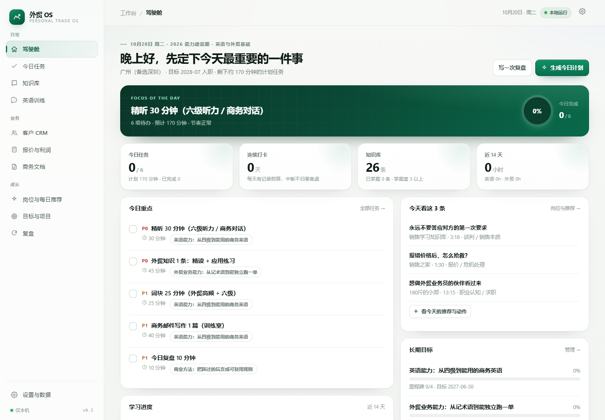

# 个人外贸操作系统 · Personal Foreign Trade OS

一个**本地优先**的个人外贸学习与业务工作台。桌面版数据存在本地 SQLite 文件里，不联网、不上传；另有 GitHub Pages 静态版，数据只存在当前浏览器。

## 在线版（手机 / 电脑都能开）

**https://haha-bool.github.io/-/**

静态版把 SQLite 编译成 WASM 放进浏览器运行，界面与桌面版一致；数据保存在当前设备的 `localStorage`（约 5MB 文本容量），所以手机和电脑各自独立、不会自动同步。首次打开会加载约 660KB 的数据库引擎，之后浏览器会缓存，打开更快。设置页仍可导出 / 导入 JSON，用来在设备间搬数据。

更新线上版：

```bash
node scripts/build-static.mjs
git add docs
git commit -m "build: refresh static site"
git push
```

## 启动

双击 **`启动工作台.cmd`**，浏览器会自动打开 `http://127.0.0.1:7788`。

关闭：在黑色命令行窗口按 `Ctrl + C`（或直接关掉窗口）。每次启动 / 关闭都会自动生成一份数据快照。

> 如果双击后窗口一闪就没了：说明脚本或 Node 环境有问题。按 `Win + R` 输入 `cmd` 回车，然后执行：
>
> ```bat
> cd /d "C:\Users\ASUS\Desktop\工作台\personal-trade-os"
> 启动工作台.cmd
> ```
>
> 这样报错会留在窗口里，把最后几行发我即可。正常情况下窗口会停在“地址: http://127.0.0.1:7788”，**不要关这个窗口**。

## 现在能用什么（第一 + 第二阶段）

| 模块 | 能做什么 |
| --- | --- |
| 驾驶舱 | 今日重点、今日跟进、每日视频、目标进度、学习曲线、连续打卡、待核实风险、报价提醒、最近复盘 |
| 今日任务 | 按模板一键生成一天的节奏、增删改任务、优先级、完成标准、顺延逾期 |
| 知识库 | 26 条外贸知识（流程 / 术语 / 单证 / 物流 / 付款 / 客户开发 / Shopee…），搜索、标签、掌握度、关联、来源与核实日期、我的笔记 |
| 英语训练 | 10 个真实业务场景（开发信、询盘、报价、跟进、议价、延误、投诉、付款、产品介绍、规格澄清）：写作 → 自检 → 本地检查 → AI 反馈包 |
| 客户 CRM | 客户（真实/模拟/练习强隔离）、联系人、跟进计划、事实/推测/待确认分层、状态机、报价与文档关联 |
| 报价与利润 | EXW / FOB / CIF / DAP / DDP 计算，成本明细、汇率、保险、关税、增值税、公式步骤、风险提示、报价复制与状态管理 |
| 商务文档 | 开发信、跟进邮件、报价单、形式发票 PI、销售合同：从客户与报价生成草稿，带 `[[ ]]` 占位，可编辑/复制/下载/保存 |
| 岗位与每日推荐 | 按 BOSS 直聘岗位要求归纳的 35 项能力画像、可粘贴真实 JD 做关键词命中分析、自评缺口、4 个详细目标（30 个里程碑）、每日 3 条外贸/销售视频 + 一个动作 |
| 目标与项目 | 5 个原有目标 + 4 个岗位目标、项目（真实 / 模拟 / 练习分开标记） |
| 复盘 | 日 / 周 / 项目复盘十问，产出可执行规则 |
| 设置 | 个人档案、文档署名、导出 / 导入、立即快照、任务模板开关 |

界面截图在 [`docs/screenshots-v03/`](docs/screenshots-v03/)（v0.3 新版 UI）。

## 目录

```
personal-trade-os/
├─ 启动工作台.cmd      ← 双击启动
├─ server.mjs          本地服务器（零第三方依赖）
├─ lib/                数据层、种子数据、API、报价引擎、文档模板、岗位与视频库
├─ public/             前端页面（原生 JS，无需构建）
├─ data/               trade-os.db + backups/
└─ docs/               产品分析、岗位能力、每日输入、使用说明、截图
```

## 界面




## 几个刻意的设计

- **不假装有 AI 评分**：英语训练室只做启发式检查 + 生成可复制的 AI 提示词，批改交给 AI 或老师。
- **不编造数据**：报价、客户、成交必须你录入；模拟项目在界面上标「模拟」。商务文档里的未知项用 `[[ ]]` 标出，不替你编。
- **报价公式透明**：每个术语都给出计算步骤和人民币口径；汇率、运费、关税、增值税都提示“需核实”。
- **动态信息标「需核实」**：关税、平台费率、政策类条目带核实日期，过期会出现在驾驶舱的待核实区。
- **目标进度 = 里程碑完成数 / 总数**，不用手填数字，避免自我安慰。
- **视频只做输入**：每条推荐必须配一个动作，标记已看也不等于能力。

详细说明见 [`docs/00-产品分析与架构.md`](docs/00-产品分析与架构.md)、[`docs/01-每日任务与周节奏.md`](docs/01-每日任务与周节奏.md)、[`docs/02-使用说明.md`](docs/02-使用说明.md)、[`docs/03-BOSS岗位能力与详细目标.md`](docs/03-BOSS岗位能力与详细目标.md)、[`docs/04-每日输入与视频推荐.md`](docs/04-每日输入与视频推荐.md)。

## 环境要求

- Windows 10 / 11
- Node.js 22 或更高（`node -v` 查看）。不需要 `npm install`，没有第三方依赖。